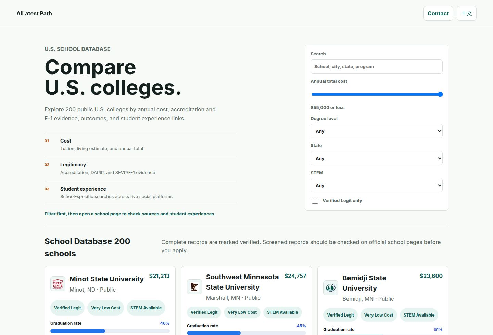
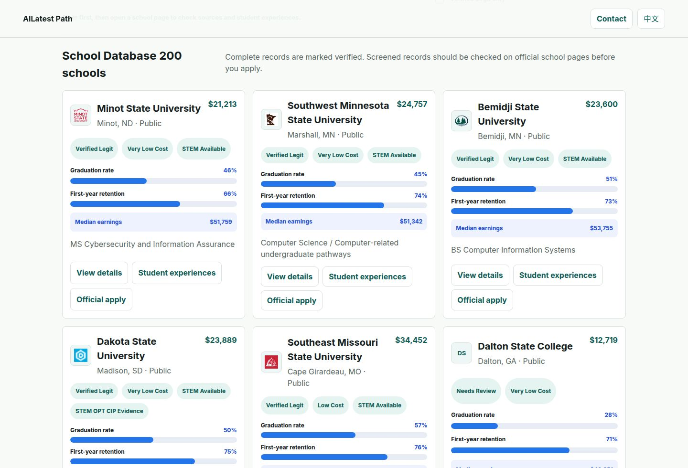
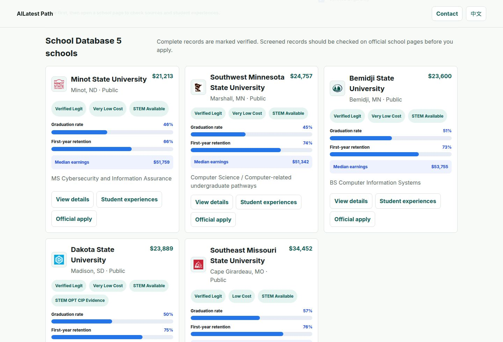
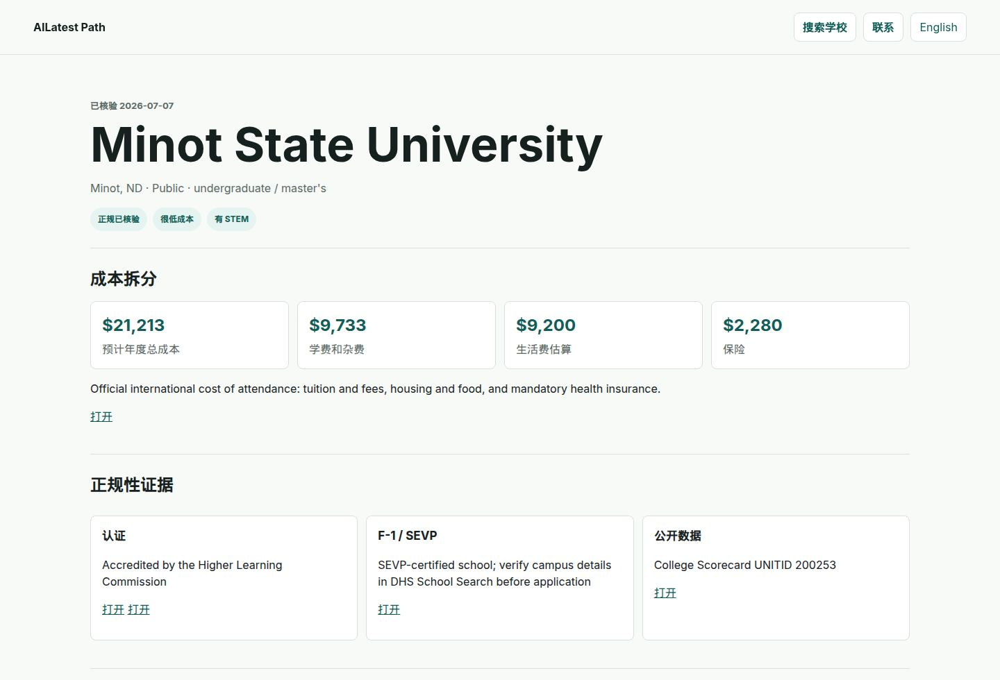
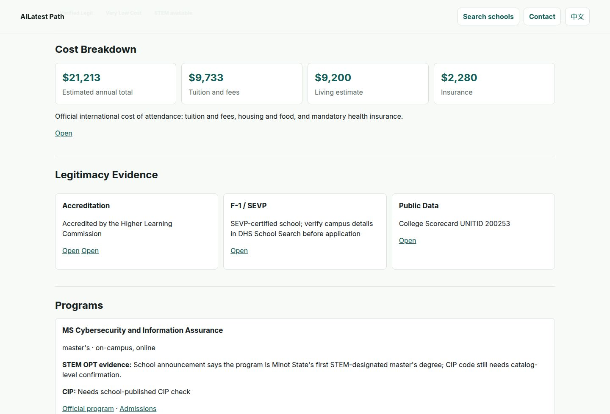
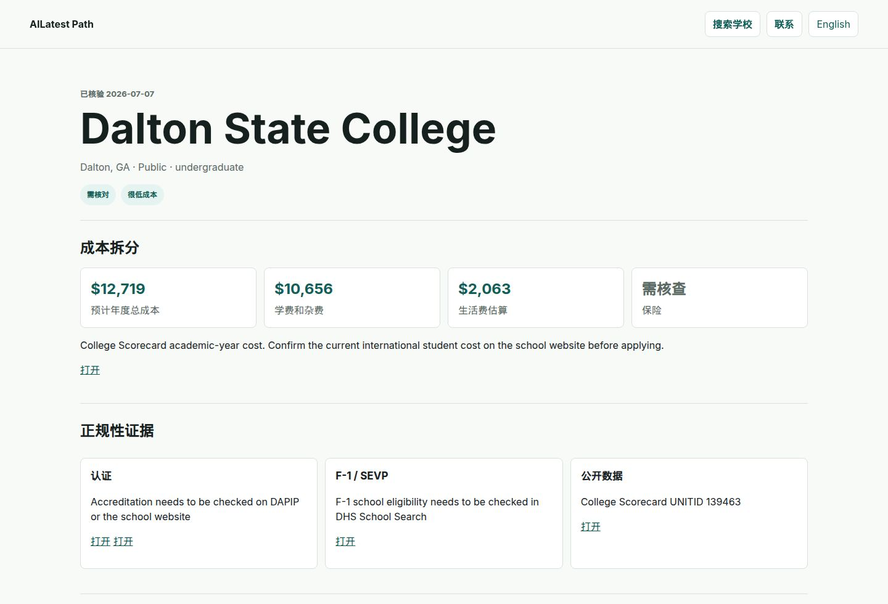
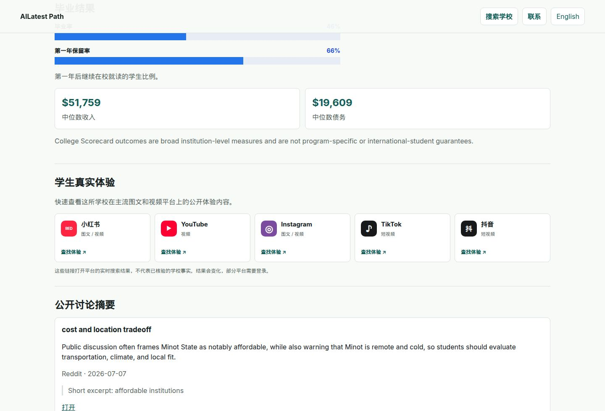
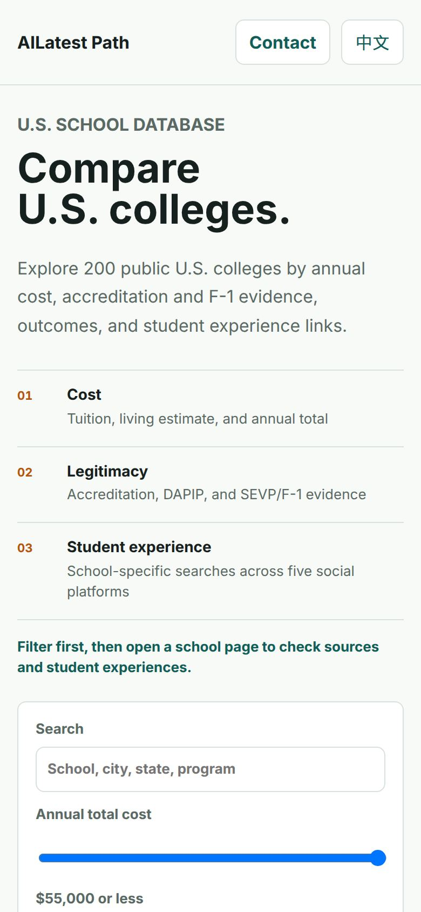
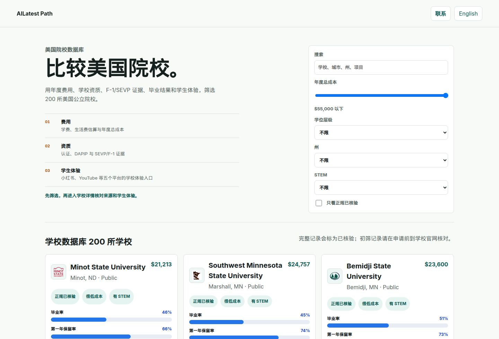
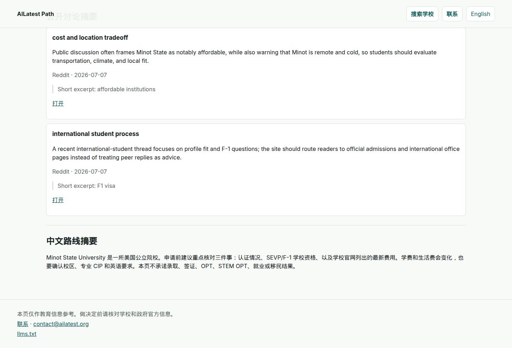

# AILatest Path

Affordable, legitimate U.S. college comparison by [AILATEST STUDIO](https://ailatest.org).

**[Open the live beta](https://path.ailatest.org)** · [AILATEST STUDIO](https://ailatest.org) · [Contact](https://path.ailatest.org/contact.html) · [中文说明](#中文)



AILatest Path is a public database for international students comparing lower-cost public colleges in the United States. Each school page shows an estimated annual cost, accreditation and F-1 evidence, College Scorecard outcomes, and links you can open yourself. The interface is English first, with a full Chinese toggle and a Chinese route summary on every school page.

This is an informational education guide. It does not promise admission, a visa, OPT, STEM OPT, a job, or an immigration outcome. Confirm the school and government pages before you apply.

## Who it is for

- International students looking for lower-cost U.S. study options and a way to see the evidence behind a school.
- Students comparing STEM availability, published outcome signals, and total cost together.
- Chinese-speaking students and families who want the same records explained in 中文.

## What you can compare

The live beta lists **200 public U.S. colleges** across **40 states**.

| Filter | What it does |
| --- | --- |
| Search | School, city, state, or program name |
| Annual total cost | Ceiling from $20,000 to $55,000 |
| Degree level | Undergraduate or master's |
| State | U.S. state |
| STEM | STEM available, or STEM OPT CIP evidence |
| Verified Legit only | Hide records that still need an official check |



A school card shows the annual total, legitimacy and cost labels, graduation rate, first-year retention, median earnings, and up to two program names when the record has them. From the card you can open the school page, jump to student-experience links, or follow the official apply link when one is stored.

### Complete records and screened records



**Verified Legit** means the record stores all three evidence gates: an accreditation source, a DHS Study in the States school-search link for SEVP / F-1 eligibility, and a College Scorecard record (UNITID, and OPEID when the record is complete). **Needs Review** means the school is in the public dataset, but accreditation or F-1 eligibility still has to be confirmed on the official pages before you apply.

In the current data files, **5** schools are Verified Legit and **195** are Needs Review. The five complete records are Minot State University, Southwest Minnesota State University, Bemidji State University, Dakota State University, and Southeast Missouri State University. Their stored accreditation text cites the Higher Learning Commission, and each page links the school source, [DAPIP](https://ope.ed.gov/dapip/), the DHS school search, and College Scorecard. Open those links. Path does not accredit schools.







### Student experience links



Every school page links a focused public search on 小红书, YouTube, Instagram, TikTok, and 抖音. These are live platform searches. Path does not scrape, republish, or verify the posts. Results change, and some platforms ask you to sign in.

### On a phone



## Languages

The default language is English. **中文** in the header switches the interface, including filters, badges, state names, and the result count. The choice is saved in the browser. Every school page also keeps a Chinese route summary.





## Data policy

Path shows evidence with a source link and a date. It is not legal, immigration, admissions, or career advice.

### Legitimacy labels

A record can be marked **Verified Legit** only when all three gates are present:

1. **Accreditation.** A school accreditation page and a DAPIP link. DAPIP is published by the U.S. Department of Education from what accrediting agencies report. The Department does not audit that feed.
2. **International-student eligibility.** A SEVP school-search link from [Study in the States](https://studyinthestates.dhs.gov/school-search). School certification is not a visa, and it is not an admission decision.
3. **Public data.** A College Scorecard record with a UNITID. Complete records also store an OPEID.

Anything short of that stays **Needs Review**. The validator also allows a **Do Not Recommend** label, and no current record uses it.

### Cost

The annual total is tuition and required fees, plus a living estimate, plus insurance when a figure is stored.

| Label | Estimated annual total |
| --- | --- |
| Very Low Cost | $25,000 or less |
| Low Cost | $35,000 or less |
| Moderate Cost | $50,000 or less |
| Higher Cost | Above $50,000 |
| Cost Needs Review | Total missing or incomplete |

In the files in this repository, estimated annual totals run from about **$13,000 to $37,000**. Counts today: 58 Very Low Cost, 115 Low Cost, 27 Moderate Cost. Two records use an official cost page that includes insurance. Three otherwise complete records still need an insurance check. Of the rest, some use the latest College Scorecard academic-year cost. The larger screened set uses Scorecard out-of-state tuition plus on-campus room and board, with a $4,500 allowance for books and other expenses. Those pages say to confirm the current international price on the school website. Federal figures lag current tuition.

### Outcomes and programs

Outcome figures are institution-level College Scorecard signals: graduation rate, first-year retention, median earnings, and median debt. They are not program-specific, and they are not a promise for any student.

Program coverage is a pilot, not a catalog. Five program notes are stored. A **STEM OPT CIP evidence** badge requires a CIP code and a stated basis. One pilot master's program currently stores a CIP code. Others tell you the CIP still needs a catalog check. A STEM-designated CIP is one input to OPT eligibility. It is not an approval.

### Public discussion

Review text is a short theme summary with a source URL, platform, and collection date. Excerpts stay very short. The site does not bulk-copy Reddit, YouTube, or forum threads. Public comments are anecdotal. Where no summary exists, the page says so.

Sources registered in `data/sources.json`:

- [College Scorecard](https://collegescorecard.ed.gov/)
- [DAPIP](https://ope.ed.gov/dapip/)
- [Higher Learning Commission directory](https://www.hlcommission.org/directory-of-institutions/)
- [DHS Study in the States school search](https://studyinthestates.dhs.gov/school-search)
- [DHS STEM OPT CIP list](https://studyinthestates.dhs.gov/stem-opt-hub/additional-resources/eligible-cip-codes-for-the-stem-opt-extension)
- Official school websites
- Public discussion pages, summarized and linked
- Generated social-search links for Xiaohongshu, YouTube, Instagram, TikTok, and Douyin

## Current snapshot

These counts come from the JSON files in this repository. Re-check the [live beta](https://path.ailatest.org) after the data changes.

| | |
| --- | --- |
| Public U.S. colleges | 200 |
| States | 40 |
| Verified Legit | 5 |
| Needs Review | 195 |
| Degree coverage | Undergraduate on all 200 records; master's on 4 |
| Program notes | 5 |
| Public discussion summaries | 4 |
| Experience-link sets | 200 schools × 5 platforms |

## Run it locally

Node.js 20 or newer. The site has no package dependencies.

```bash
npm run check   # validate institutions, costs, programs, outcomes, reviews, and experience links
npm run build   # write the static site to dist/
npm run dev     # build, then serve dist/ at http://localhost:4173
```

Set `PORT` to serve on another port.

| Script | What it does |
| --- | --- |
| `npm run check` | Fails if a Verified Legit record is missing a gate, a cost is missing a source, or an experience-link set is incomplete |
| `npm run build` | Writes the list page, one page per school, the contact page, `sitemap.xml`, and `robots.txt` |
| `npm run dev` | Builds, then serves `dist/` |
| `npm run build:experience-links` | Rewrites `data/experience_links.json` with school-specific search URLs |
| `npm run import:scorecard` | Fetches College Scorecard fields and prints them. Set `SCORECARD_API_KEY` in the environment if you have one |
| `npm run import:ipeds` | Planned. Prints that the importer is not implemented |
| `npm run import:dapip` | Planned. Prints that the importer is not implemented |
| `npm run import:sevp` | Planned. Prints that the importer is not implemented |
| `npm run deploy:domain` | Deploys the Cloudflare route for `path.ailatest.org`. Needs an authenticated Wrangler session |

`dist/` is generated and gitignored.

## Repository

```text
data/       institutions, costs, programs, outcomes, reviews, sources, experience links
src/        page behavior, English/Chinese copy, styles
scripts/    validate, build, local server, Scorecard fetch, experience-link generator
PLAN.md     product direction and the rules the validator enforces
```

Corrections and source updates: [contact@ailatest.org](mailto:contact@ailatest.org). Include the school name, the field, the official source URL, and the publication date. Do not email passwords, verification codes, passport details, or other sensitive personal information.

## 中文

AILatest Path 是 [AILATEST STUDIO](https://ailatest.org) 做的美国公立院校比较库，用来查看费用、资质证据和公开结果。

**[打开线上 Beta](https://path.ailatest.org)** · [工作室主页](https://ailatest.org) · [联系](https://path.ailatest.org/contact.html)


这个库面向想比较美国低成本公立院校的国际学生，也面向需要中文说明的学生和家庭。页面默认英文。页眉的 **中文** 会切换界面语言，并记在浏览器里。每所学校详情页都有一段中文路线摘要。

本项目只提供教育信息。它不承诺录取、签证、OPT、STEM OPT、就业或移民结果。申请前请自己打开学校官网和政府页面核对。

### 可以比较什么

线上 Beta 目前收录 **200 所美国公立院校**，分布在 **40 个州**。

可以按学校、城市、州或项目名称搜索，并筛选年度总成本上限、本科或硕士、所在州、是否有 STEM、是否有 STEM OPT 的 CIP 证据，以及是否只看「正规已核验」。


**正规已核验** 表示这条记录同时有三项证据：认证来源、美国国土安全部 Study in the States 的 SEVP / F-1 学校检索链接，以及 College Scorecard 公开数据（含 UNITID；完整记录还有 OPEID）。**需核对** 表示学校已经进入公开数据集，但认证或 F-1 资格仍要到官方页面确认。

当前数据里，5 所是正规已核验，195 所是需核对。五所完整记录是 Minot State University、Southwest Minnesota State University、Bemidji State University、Dakota State University 和 Southeast Missouri State University。记录中的认证文字指向 Higher Learning Commission，并附上学校页面、[DAPIP](https://ope.ed.gov/dapip/)、DHS 学校检索和 College Scorecard 链接。请打开这些链接自己看。Path 不负责给学校做认证。


### 学生体验链接

每所学校都有小红书、YouTube、Instagram、TikTok、抖音五个平台的检索入口。这是跳转到平台自己的搜索结果，不是抓取来的帖子，也不能当成已核验事实。结果会变，部分平台需要登录。


### 数据和口径

- **费用。** 年度总成本 = 学费和杂费 + 生活费估算 + 有数字时的保险。很低成本 ≤ 25,000 美元，低成本 ≤ 35,000 美元，中等成本 ≤ 50,000 美元。当前文件里的估算大约在 **1.3 万到 3.7 万美元**。两条记录用的是含保险的学校官网费用；另外三条较完整的记录仍缺保险核对。其余记录里，一部分用 College Scorecard 最新学年费用，更大的一批初筛记录用的是 Scorecard 州外学费加上校内食宿，并加入 4,500 美元的书本和其他开支余量。这些页面都会要求你到学校官网核对当年国际学生费用。联邦数据会滞后。
- **结果。** 毕业率、第一年保留率、收入中位数、债务中位数来自 College Scorecard，是学校整体指标，不是某个专业的结果，也不是对某个学生的保证。
- **项目。** 目前只有 5 条试点项目记录，不是完整专业目录。STEM OPT 徽章需要 CIP 代码和依据。当前只有一条试点硕士项目写了 CIP，其余会标明还要到课程目录核对。
- **公开讨论。** 只保留短摘要、来源链接、平台和采集日期，不整段转载评论。没有摘要时，页面会直接写明。
- **DAPIP。** 数据由认证机构报送，美国教育部不审计这份数据。

### 本地运行

需要 Node.js 20 或更高版本。项目没有需要安装的运行依赖。

```bash
npm run check   # 校验院校、费用、项目、结果、讨论摘要和体验链接
npm run build   # 生成静态站点到 dist/
npm run dev     # 构建后在 http://localhost:4173 打开
```

可用 `PORT` 改端口。`npm run import:scorecard` 会读取环境变量 `SCORECARD_API_KEY` 并向终端打印 College Scorecard 字段，不会自行改写数据文件。`import:ipeds`、`import:dapip`、`import:sevp` 仍是计划中的导入命令。`dist/` 由构建生成，不进入 git。

数据纠错请写信到 [contact@ailatest.org](mailto:contact@ailatest.org)，写明学校名称、字段、官方来源链接和发布日期。请勿发送密码、验证码、护照或其他敏感个人信息。
