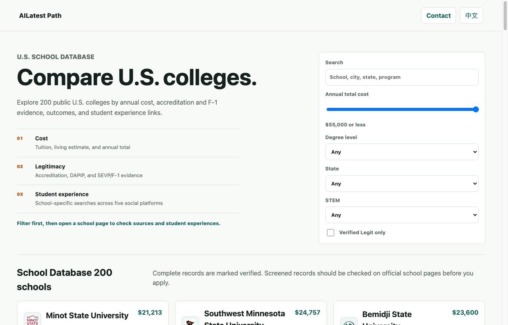

# AILatest Path · 美国大学高性价比留学对比 🎓

  <b>美国正规留学院校学费、奖学金、真实生活开销与毕业薪酬全景对比。</b> 
  用真实数据量化留学投入产出比（ROI），帮你找到最适合自己的求学路径。

  
  

---

## 🖼 视觉预览 · Visual Overview

### 1. 官方封面插画

  

### 2. 真实在线院校对比界面截图 (Live Application Interface)

  

<em>界面截图截取自线上站点 <a href="https://path.ailatest.org/">path.ailatest.org</a>。</em>

---

## 🌟 核心对比维度

- **真实学杂费与隐性开支**：不仅看官网标准 Tuition，更拆解地域生活成本、住宿支出与保险费用。
- **奖学金发放率与工读机会**：统计不同院校向国际学生提供 Merit-based / Need-based 资助的真实比例。
- **毕业薪酬中位数与 OPT 留美政策**：量化毕业生首年薪酬中位数与行业雇主偏好。

---

## 🌐 在线对比选校

立即开始对比高校：[**https://path.ailatest.org/**](https://path.ailatest.org/)\n